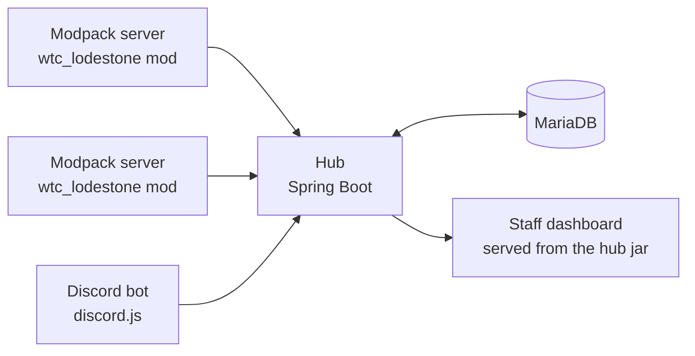

# WTC Lodestone

Cross-server integration for the **WTC Network**. A server-side NeoForge mod runs on each modpack
server and checks in with a central service (the **hub**), which gives staff one place to see every
server's health, one whitelist shared across the whole network, and a Discord bot that can approve
applications and link accounts without anyone touching a server console.

What it does today:

- **Server status** — each server reports players online, TPS, tick time and memory on a timer; the
  hub derives `ONLINE` / `LAGGING` / `OFFLINE` from those heartbeats and keeps a history to chart.
- **Network whitelist** — one list on the hub, mirrored into every server's `whitelist.json`.
- **Staff dashboard** — React app served by the hub, live-updated over a WebSocket.
- **Discord** — applications with staff approve/deny, and Discord ↔ Minecraft account linking.

---

## How it works



Every arrow points at the hub, and that is the whole design:

- **The mod only calls out.** It POSTs `hello` on startup, then heartbeats on a timer, and polls the
  whitelist to apply it locally. Nothing ever calls *into* a game server.
- **The hub owns the timing.** It answers `hello` with the heartbeat interval, so changing the
  cadence is a hub setting that servers pick up on their next restart.
- **The bot is just another admin.** It signs in to the hub's admin API with a username and
  password like a dashboard user, rather than having an API of its own or touching RCON.
- **Servers never talk to each other**, and the mod stays idle and harmless if the hub is
  unreachable or unconfigured — hub calls are async, and a failure only logs a warning.

---

## Repository structure

| Folder | What it is |
|---|---|
| `mod/` | Server-side NeoForge 1.21.1 mod (`wtc_lodestone`); `common/` holds the loader-free code |
| `hub/` | Spring Boot service: REST API, WebSocket, and it serves the dashboard |
| `hub/src/main/frontend/` | Dashboard (React + Vite, plain JS/JSX), built into the hub jar |
| `discord/` | Discord bot (discord.js): applications, approvals, account linking |
| `deploy/` | Dev database compose file, plus the production runbook, systemd units and nginx config (`deploy/README.md`) |

The three projects share no code, only HTTP. The mod and the hub are separate Gradle builds; the bot
is a plain Node project.

---

## Tech stack

- **Mod:** NeoForge 1.21.1, Java 21, ModDevGradle
- **Hub:** Spring Boot, Java 21, Spring Data JPA, Flyway, Spring Security
- **Database:** MariaDB
- **Dashboard:** React, Vite, plain JS/JSX, ESLint
- **Bot:** Node.js 22, discord.js
- **Infra:** Docker Compose (dev), systemd + nginx on one Linux box (prod), GitHub Actions

---

## Getting started

### Prerequisites

- JDK 21
- Node.js 22+ for the bot (the hub's build downloads its own Node for the dashboard)
- MariaDB — via Docker Desktop, or installed locally

### 1. Database

With Docker:

```bash
docker compose -f deploy/docker-compose.dev.yml up -d
```

Without Docker, create the database and user manually:

```sql
CREATE DATABASE wtc_lodestone;
CREATE USER 'lodestone'@'localhost' IDENTIFIED BY 'lodestone';
GRANT ALL PRIVILEGES ON wtc_lodestone.* TO 'lodestone'@'localhost';
```

Flyway creates and migrates the tables on the hub's first start.

### 2. Hub

```bash
cd hub
./gradlew bootRun        # Windows: .\gradlew.bat bootRun
```

Runs on `http://localhost:8080`, dashboard included. The API browser is at
`http://localhost:8080/swagger-ui.html`.

### 3. Dashboard (development)

```bash
cd hub/src/main/frontend
npm install
npm run dev
```

The dev server proxies `/api` — WebSocket included — to the hub on port 8080, so run `bootRun`
alongside it. For production the dashboard is built into the hub jar automatically.

### 4. Mod

```bash
cd mod
./gradlew :neoforge:runServer      # Windows: .\gradlew.bat :neoforge:runServer
```

On the first run, accept the EULA in `mod/run/eula.txt` and run again.

### 5. Discord bot

```bash
cd discord
cp .env.example .env     # bot token, client/guild id, and the hub account to sign in with
npm install
npm run deploy           # registers the slash commands; re-run after changing one
npm start
```

It needs a running hub and an admin account seeded for it (`lodestone.admins` in
`hub/src/main/resources/application.yaml`). Everything else it needs lives on the hub — see
[`discord/README.md`](discord/README.md).

### Production

One Linux box, no Docker: systemd for the hub and the bot, nginx in front, nightly database dumps.
The runbook is [`deploy/README.md`](deploy/README.md).

---

## Mod configuration

Config file: `config/wtc_lodestone-common.toml` (in dev: `mod/run/config/`).

| Option | Default | Description |
|---|---|---|
| `enabled` | `true` | Master switch |
| `dryRun` | `false` | Log events instead of sending them |
| `hubUrl` | `http://127.0.0.1:8080` | Hub base URL |
| `serverId` | *(empty)* | Unique id of this server, e.g. `genesis` |
| `token` | *(empty)* | Auth token generated by the hub — keep it secret |
| `syncWhitelist` | `true` | Mirror the network whitelist from the hub into this server's `whitelist.json` |
| `whitelistMessage` | *(empty)* | Kick message for players who aren't whitelisted. Empty keeps Minecraft's own wording; `\n` makes a line break |

With `syncWhitelist` on, the whitelist is applied at startup and then on the hub's heartbeat
interval (60 seconds by default), and the hub's list is the source of truth: local `/whitelist
add`/`remove` changes are overwritten on the next sync. Before rolling the mod out, import each
server's existing `whitelist.json` on the dashboard — while the hub's list has never been
populated, servers keep their own whitelist untouched.

Removing someone only disconnects them if that server's `server.properties` has
`enforce-whitelist=true`; the dashboard flags the servers where it is off.

The mod stays idle until `serverId` and `token` are set. It is **server-only**: players do not need
it installed.

---

## Documentation

- [`deploy/README.md`](deploy/README.md) — production setup and the deployment runbook
- [`discord/README.md`](discord/README.md) — the bot's commands, config and hub account
- `http://localhost:8080/swagger-ui.html` — the hub's API, on a running hub

---

## License

MIT — see [LICENSE](LICENSE).
